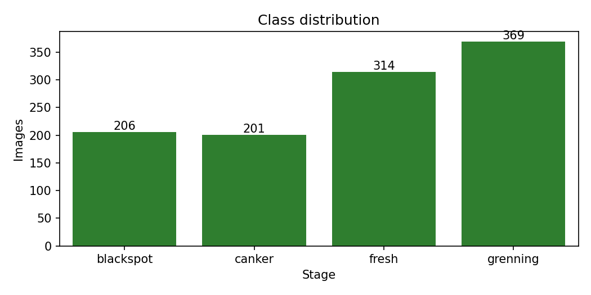
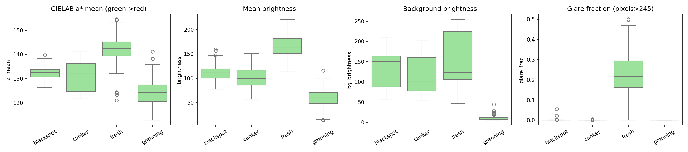
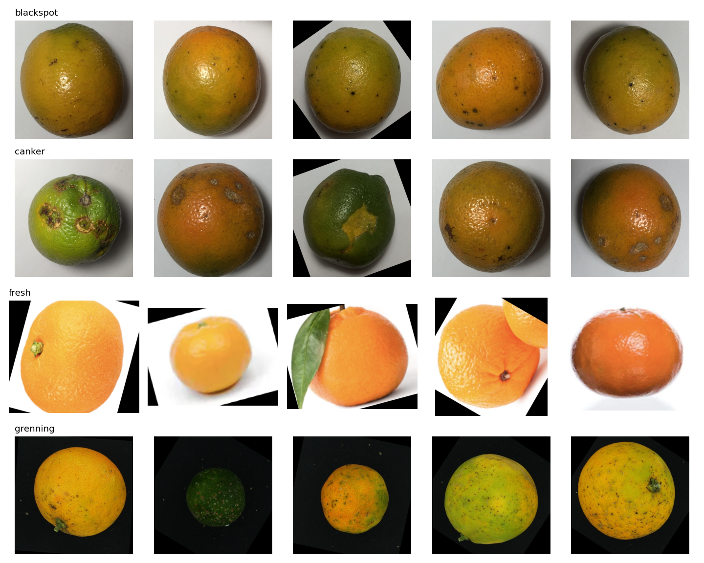
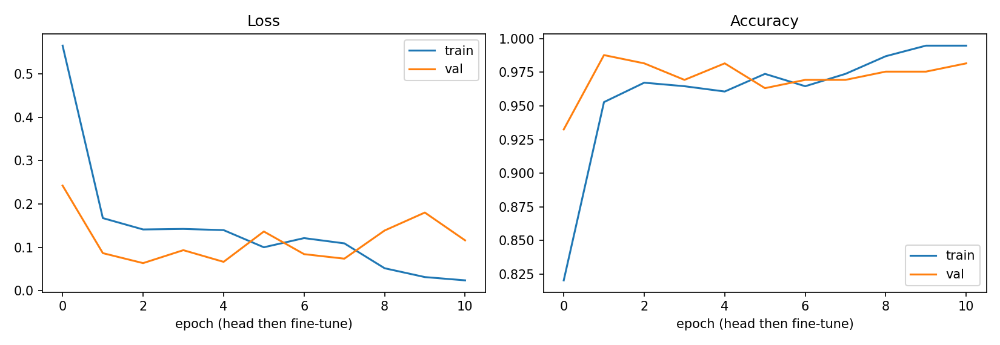
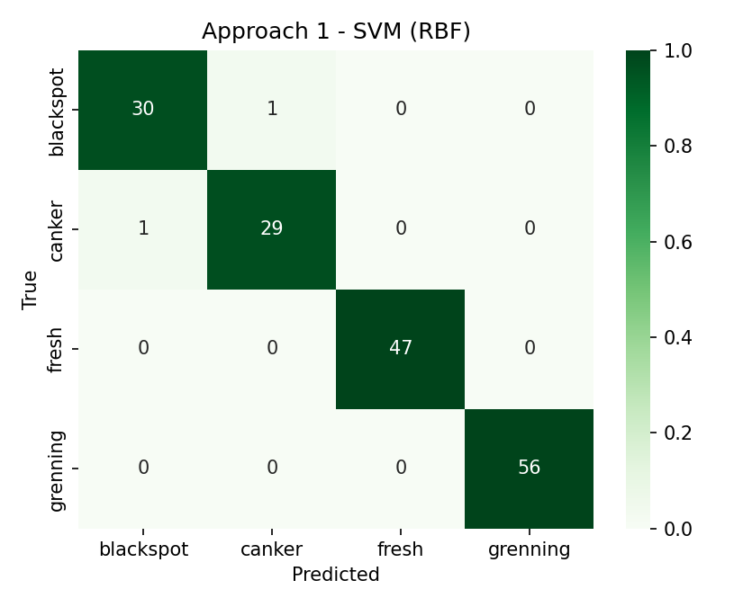
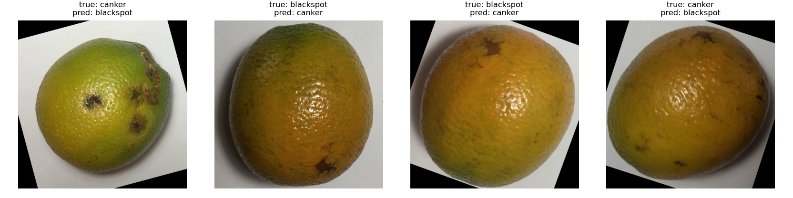
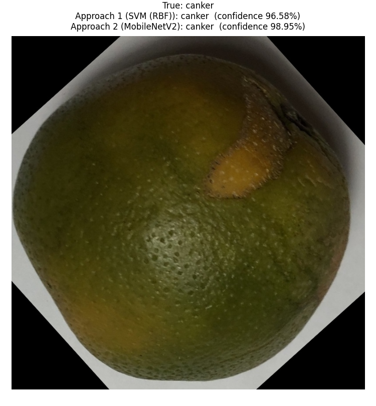

# Fruit Condition Detection & Classification - Assignment 2 (Greenpod Labs)

Submitted by: Prateek Sahu (GitHub: prateek2004sahu)

## 1. Understanding of the Dataset

The supplied dataset contains 1090 images in 4 classes (blackspot, canker, fresh, grenning). Cleaning removed 0 unreadable file(s) and 0 exact duplicate(s). Note: the sample images show citrus-type fruit and the class labels are fruit conditions/diseases rather than avocado ripening stages. The pipeline reads class names from the folders, so it applies unchanged to ripening-stage labels.

- Class imbalance: largest class 'grenning' has 369 images, smallest 'canker' has 201 (ratio 1.84:1) - moderate. Handled with stratified splits, class-weighted loss/classifiers and macro-F1 for model selection.
- Resolution variation: 149 distinct image sizes (most common 800x800); all images are resized to a uniform size.
- Background/lighting bias (most important finding): mean background brightness differs strongly by class - blackspot 130.2, canker 117.3, fresh 149.9, grenning 9.9. 'grenning' images have a near-black background while 'fresh' images are bright/white. A model can therefore partly learn the background instead of the fruit.
- Likely augmented copies: several sample images are rotated with black corners, suggesting augmented versions of the same fruit are present. If copies of one fruit fall into different splits, test scores are optimistic (data leakage); the exact-duplicate check cannot detect rotated copies.
- Outliers: 0 brightness outliers (IQR rule) in 1007 sampled images; mean glare fraction 0.0658 (specular highlights on shiny skin).
- Edge cases: small lesions (black spot vs canker) are visually similar at low resolution; fruit colour varies inside a class.

## 2. Understanding of Model Selection

Data split: stratified 70% train / 15% validation / 15% test (seed 42). The test set was used only once, for the final comparison.

- Approach 1 - Classical CV + ML: HSV and CIELAB colour histograms and statistics plus Local Binary Pattern (LBP) texture histograms, fed to an RBF-SVM (tuned with 3-fold CV) and compared with a Random Forest on validation macro-F1. Why: the classes differ in colour and skin texture (lesions, spots), the feature vector is small and interpretable, training takes seconds on a CPU, and it works well with ~1,000 images. class_weight='balanced' handles imbalance.
- Approach 2 - MobileNetV2 transfer learning: ImageNet-pretrained backbone, new head (128 units, dropout 0.2); first only the head is trained, then the last blocks are fine-tuned at a low learning rate, with Adam, class-weighted cross-entropy and early stopping on validation loss. Why: it learns colour, texture and lesion shape end to end, is small (about 3.4M parameters) and fast enough for edge/real-time use, and transfer learning suits a small dataset.
- Augmentation (deep learning): random resized crop, flip, rotation, brightness/contrast jitter. Hue jitter is intentionally disabled because colour carries class information.

## 3. Understanding of Evaluation Metrics

- Accuracy: overall share of correct predictions - a baseline that can hide weak results on smaller classes under imbalance.
- Precision: of the images predicted as a class, how many truly belong to it - low precision for 'fresh' would mean damaged fruit passed as good.
- Recall: of the images that truly belong to a class, how many were found - low recall for a disease class means diseased fruit is missed.
- F1-score (macro): harmonic mean of precision and recall averaged equally over classes; the primary selection metric because it is not dominated by large classes.
- Confusion matrix: shows exactly which classes are mixed up.

| Model | Accuracy | Precision (macro) | Recall (macro) | F1 (macro) | CPU ms/img | Size MB |
|---|---|---|---|---|---|---|
| Approach 1: SVM (RBF) (HSV+LAB+LBP) | 0.9878 | 0.9836 | 0.9836 | 0.9836 | 11.2 | 0.2 |
| Approach 2: MobileNetV2 transfer learning | 0.9756 | 0.9672 | 0.9672 | 0.9672 | 35.2 | 9.8 |

Test set: 164 images. Best model by macro-F1: Approach 1: SVM (RBF) (HSV+LAB+LBP) (F1 0.9836, accuracy 0.9878). On this test set Approach 1 made 2 error(s); Approach 2 made 4 error(s). With so few errors the gap between the two models is small and may not be meaningful, so speed, size and robustness also matter for the final choice: the classical model is smaller and faster on CPU, while MobileNetV2 is expected to generalise better to new backgrounds and cameras once it is trained on more varied data.

Error analysis (Approach 1: SVM (RBF) (HSV+LAB+LBP)): weakest class 'canker' (F1 0.967). Confusions: 1 image(s) of 'canker' predicted as 'blackspot'; 1 image(s) of 'blackspot' predicted as 'canker'. Both models make their few mistakes between the two visually similar lesion classes, while the classes with a distinctive background and colour are classified perfectly - consistent with the background bias described in section 1.

## 4. Example Run

Command: python main_demo.py <image>. It classifies one image with both approaches and prints the label and confidence.

## 5. Mandatory End-of-Assignment Questions

### Q1. In production, how does your model perform?

On the held-out test set the best model (Approach 1: SVM (RBF) (HSV+LAB+LBP)) reached accuracy 0.988 and macro-F1 0.984. Measured CPU latency at batch size 1, including pre-processing: Approach 1: 11.2 ms/image; Approach 2: 35.2 ms/image. This is fast enough for a sorting line or a mobile app. However, these scores come from a dataset where the background and lighting differ by class, and possibly from augmented copies of the same fruit, so real-world accuracy with one fixed background, a new camera or different lighting is likely to be lower. A fixed lighting/background setup and re-validation on newly collected images are recommended before deployment.

### Q2. What are the drawbacks of your model?

- Background shortcut: classes have very different backgrounds, so the model may rely on them instead of the fruit itself.
- Possible leakage from augmented/rotated copies of the same fruit across train and test, which inflates scores.
- Visually similar lesion classes (black spot vs canker) are the main source of errors.
- Limited data (1090 images) and moderate imbalance (1.84:1); a single view of the fruit cannot show damage on the hidden side.
- The classical model depends on hand-designed features; MobileNetV2 is less interpretable and needs more compute to train.

### Q3. If given more time, what would you improve?

- Remove the background (segmentation or centre crop) or collect images on one standard background, and split by original fruit so no copy leaks across splits.
- Collect more and more varied images (lighting, cameras, varieties) and have several annotators verify the labels.
- Use higher input resolution or a crop around lesions to separate black spot from canker.
- Try EfficientNet/ConvNeXt-Tiny, test-time augmentation and probability calibration; use Grad-CAM to confirm the model looks at the fruit.
- Quantise to ONNX/TensorRT INT8 for faster edge inference and monitor for data drift in production.

### Q4. Where did you spend the most time?

Total effort was about 10 hours. Most of it went into understanding the data and building the classical feature pipeline:

- Data understanding and cleaning (class balance, duplicates, background and lighting analysis, noticing the dataset mismatch) - about 3 hours (30%).
- Feature engineering and colour-space tuning (RGB vs HSV vs CIELAB, LBP, SVM/Random Forest tuning) - about 3.5 hours (35%).
- MobileNetV2 training and fine-tuning, evaluation, error analysis and writing the report - about 3.5 hours (35%).
